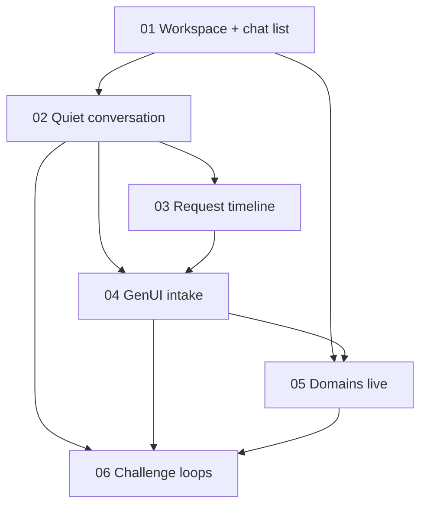

# Prompt Plan

## Developer Overview

- **Goal:** شِل agent شبیه Cursor: اول فولدر workspace → چت‌های همان فولدر؛ محاوره کم‌نویز + GenUI + تایم‌لاین وابسته به درخواست؛ Domains واقعی؛ حلقه‌های `challenge.md` از چت کار کنند.
- **Expected outputs:** `src/` shell (workspace gate, scoped chats, quiet chat, timeline, GenUI) + `apps/agent` (expose domains list/ops as needed, inject `app_path`) + verification of challenge journeys.
- **Ownership:** UI `src/`; BFF `apps/agent`; conversations localStorage keyed by folder; Liara via existing client.
- **Open now:** Auto-run **complete** — all 6 slices finalized. Review/submit remain manual.

## Decision Topics

| Topic | Status | Current answer | Next question |
| --- | --- | --- | --- |
| Outcome | decided | UX + عملکرد طبق `challenge.md` | — |
| Domains / nav | decided | Domains واقعی از Liara API | — |
| Capability bar | decided | Setup/deploy، ops، monitor، troubleshoot، HITL، Domains | — |
| Chat noise | decided | چت = محاوره + GenUI + HITL + خلاصه مفید | — |
| Timeline | decided | مراحل بر اساس درخواست کاربر | — |
| Intake GenUI | decided | بعد از روشن شدن intent؛ فقط فیلدهای لازم با GenUI در چت | — |
| Deploy target / Workspace | decided | مثل Cursor: اول فولدر سیستم؛ چت‌ها داخل همان workspace؛ agent با `app_path` به CLI محلی و با intake به API لیارا دسترسی دارد | — |
| Chat list | decided | لیست چت scoped به فولدر workspace؛ موارد general جدا از workspace | — |
| Agent UX skill | decided | L02 applied — `.cursor/skills/agent-workspace-ux` | — |
| Prompt list | decided | 6 slices agreed (2026-10-23) | — |

## Run Mode

- mode: auto
- run state: complete
- enabled by: `/hitl-define --skills-first --auto` + list agreement (2026-10-23)
- pause reason: (none)
- completed: 2026-10-23 — all 6 agreed slices finalized

## Source Identity

| Source | Ref | Authority |
| --- | --- | --- |
| User intention | chat 2026-10-23 (FA) | Primary product intent |
| Challenge brief | `challenge.md` | Challenge UX + Liara companion capabilities |
| Prior shell work | `.hitl/prompts/cursor-agent-shell/` (complete) | Prior wiring of Vite shell ↔ `apps/agent` |
| Current UI | `src/App.tsx`, `NavigationView.tsx`, GenUI cards | Observed behavior (noise, Domains stub) |

## Task Framing

- **Outcome (decided 2026-10-23):** UX پیشنهادشده (چت محاوره‌ای کم‌نویز، GenUI intake، تایم‌لاین مفید، لیست چت، nav درست) **و** عملکرد مطابق قابلیت‌های مورد انتظار `challenge.md`. کاربر تأیید کرد: موافق UX، ولی عملکرد هم مهم است و باید طبق challenge کار کند.
- **Affected:** End users (FA/RTL); `src/` chat shell, Inspector, nav; `apps/agent` loops that power challenge capabilities.
- **Scope:** Folder-first workspace gate; chats scoped to folder; conversation + GenUI + request-derived timeline; nav/Domains; challenge capability loops via local folder (CLI/fs) + Liara APIs; general/account surfaces may sit outside workspace.
- **Non-goals:** Full Cursor IDE clone (patterns are directional); inventing unsupported Liara APIs; unrelated refactors.
- **Deliverable types:** Code (UI + BFF as needed), verification of UX journeys **and** challenge capability paths.

## Selected Skills

| Path | Reason | Status |
| --- | --- | --- |
| `.cursor/skills/discovery-orchestrator/SKILL.md` | Definition coordination | active |
| `.cursor/skills/ux-design/SKILL.md` | Chat noise, conversation flow, chat list, nav UX | active |
| `.cursor/skills/investigation-debugging/SKILL.md` | Domains / broken surfaces — evidence before fix scope | active |
| `.cursor/skills/api-design/SKILL.md` | If chat↔orchestrator contracts must change to stop dumping internals | deferred until needed |
| `.cursor/skills/system-architecture/SKILL.md` | Challenge capability loops through cleaned chat surface | active (light) |
| `.cursor/skills/agent-workspace-ux/SKILL.md` | Cursor-like workspace/chat shell (L02 applied) | active |

### Skills-first preflight (2026-10-23)

- **Findings:** No new skill bodies required. Noted that prior plan referenced `generative-ui` / `agent-orchestration` which are **not present** on disk and **not** in specialist catalog; user chose not to add skills.
- **Requested additions:** none
- **Approval outcomes:** n/a
- **Explicit no-more-skills confirmation:** developer «دیگر مهارتی اضافه نشود» (2026-10-23) — gate cleared; definition started.

## Source Requirements

### From user (supplied)

- همراه لیارا باید برای deploy/debug و کار با Liara API/CLI کمک کند؛ الان تجربهٔ مفید نیست.
- سایدبار/چت پر از متن بی‌فایده است (نتیجه بررسی آمادگی، UUID پرونده، مدل آماده، گام‌های create_case/assess_readiness، سابقه اقدامات مبهم) — **نمی‌خواهد این‌ها را ببیند**.
- اطلاعات **کم ولی به‌دردبخور**.
- تایم‌لاین از کارهای در حال انجام، اما نه گنگ/مبهم.
- محاوره ادامه پیدا کند تا کاربر درخواستش را بگوید؛ بعد پرسیدن سرویس/پلن و GenUI در همان چت.
- بخش لیست چت‌ها لازم است.
- دامنه‌ها کار نمی‌کنند؛ هر صفحه‌ای هست باید درست کار کند.
- (clarified) موافق UX پیشنهادی؛ **عملکرد طبق `challenge.md` هم الزامی است**.

### From `challenge.md` (authoritative capability bar — pending which are acceptance for this task)

- Initial setup & first deploy (guide method, suggest infra/plan, help configure/deploy, domain guidance e.g. Irnic when needed).
- Deployment & operations (new releases, config via Liara APIs, deploy status/errors, automate repeats).
- Monitoring & maintenance (health/resources if available, logs, slowdown/resource issues, remediation advice/actions).
- Intelligent troubleshooting (gather evidence, prioritize causes, propose fix, act with permission).
- HITL for sensitive ops; show results/errors; distinguish low-risk auto vs approval-required.
- Where Liara API cannot support something: **clearly tell the user** (not silent failure).

### From repo evidence

- `startOrchestratorGoal` in `src/App.tsx` eagerly create_case → assess_readiness → create_plan and surfaces readiness/timeline/tool names into UI.
- GenUI already has `readiness_findings` card titles («نتیجه بررسی آمادگی»).
- Conversations persisted via `src/lib/conversations.ts` (localStorage, max 8); History nav exists; sidebar may not emphasize chat list as primary.
- Domains **UI** is stubbed, but `apps/agent` already has Liara domain ops: `list_domains`, `create_domain`, `set_domain_project`, `check_domain`, `provision_ssl`, plus HITL write_guard / domain_ssl plans. Gap is wiring nav + chat GenUI to those APIs, not inventing Liara support.

## Clarifications

- Outcome: UX + challenge functionality both in scope (2026-10-23).
- Domains: Liara APIs for connect/list/SSL (2026-10-23).
- Capability bar: full package accepted (2026-10-23).
- Chat noise: chat = conversation + GenUI + HITL + useful summaries; no readiness/UUID/internal tool dumps (2026-10-23).
- Timeline: built from the user's request / plan for that goal — not a fixed create_case→assess_readiness pipeline (2026-10-23).
- Intake GenUI: intent-first, then only needed fields via in-chat cards (2026-10-23).
- Workspace: Cursor-like — select OS folder first; chat list lives under that folder; agent uses folder for local CLI/fs; Liara cloud target still via GenUI/API; general surfaces may be outside workspace (2026-10-23).
- Chat list: scoped to selected workspace folder (2026-10-23).

## Structure and Boundaries

- Domains: product surface must use Liara domain APIs (list/attach/SSL as already modeled in agent); no fake domain list.
- Capability acceptance: challenge loops above must work through cleaned chat UX.
- Chat surface: user-facing dialogue and interactive cards only; internal orchestrator telemetry stays out of message bubbles.
- Progress/timeline: request-derived user-facing steps (titles/status in FA-friendly language); updates as the plan for that intent progresses.
- Workspace gate: no project-bound chat/deploy until a local folder is selected; `app_path` = that folder for agent/CLI; conversation history keyed by workspace folder; account/general nav may remain available without a folder.

## Technical Decisions

- Local project truth: selected workspace folder path (`app_path`) for filesystem + Liara CLI on the machine.
- Cloud target truth: Liara service/plan/domain via API + GenUI after intent (not inferred from folder alone).
- Conversation persistence: scoped to workspace folder identity (exact keying TBD in implementation slice).
- Visual/UX authority: existing Vite shell + directional Cursor/popular agent patterns; standing guidance `agent-workspace-ux` (L02 applied 2026-10-23).

## Supporting Inputs

- No separate visual design files supplied; authority = user UX requirements + existing Vite shell patterns.
- Visual designs: not supplied; will confirm material design expectations from current shell if Outcome stays UI-heavy.

## Assets

(none)

## Conflicts / Open Questions

- Prior shell work left orchestrator dump UX + Domains stub; this task fixes presentation and wires remaining surfaces.

## Deliverables and Evidence of Success

### Capability (decided)

- User can complete challenge-aligned journeys via chat: setup/first deploy, deploy/ops, monitoring/maintain, troubleshooting, domain attach via Liara API, with HITL approve for sensitive writes.
- Unsupported API cases (if any remain) are announced clearly — not silent/broken UI.

### Chat presentation (decided)

- Starting/continuing a chat does not dump readiness findings, case UUIDs, model-ready strings, or raw tool ids into the transcript.
- Chat shows assistant conversation, GenUI intake, approval prompts, and concise useful outcomes.
- Timeline steps are generated for the specific user request (e.g. deploy vs troubleshoot vs domain), not a generic internal checklist.
- GenUI intake appears only after intent is clear; fields depend on intent (service, plan, domain name, etc.).
- User selects a local workspace folder before project chats; chat list is per folder; deploy knows the code root from that folder; Liara service still chosen via intake/API.

## Assumptions

- FA/RTL remains first-class (from prior plan).
- Propose≠execute / HITL approval buttons remain required for writes (challenge + prior decisions).

## Repository Quality Contract

- Ground in root `README` / `apps/agent/README` / Vite `src/`.
- FE: `npm test` (vitest), `npm run build` when UI contracts change.
- Agent: `cd apps/agent && uv run pytest` for touched Python tests.
- No universal monorepo lint; do not claim App Factory pnpm filters for this repo.
- Do not deploy or call paid Liara writes in verification without HITL/user auth; prefer mocked client tests + UI state checks.

## Prompt Decomposition Strategy

Vertical slices: workspace foundation → quiet conversation → timeline → GenUI intake → Domains surface → challenge-loop verification/fix. Sequential default (shared `src/App.tsx`); Domains BFF can start after workspace but UI merges after quiet chat to reduce conflict.

## Agreed Prompt List

Agreed 2026-10-23 (developer «بله»). Auto-run authorized.

| # | Title | Goal / output | Deps | Acceptance evidence | Parallel | Status |
| --- | --- | --- | --- | --- | --- | --- |
| 01 | Workspace + chat list | Folder picker gate; chats keyed by folder; sidebar list for current workspace; general nav OK without folder | — | Open folder → scoped chats; switch folder → different list; no project chat without folder | no | finalized |
| 02 | Quiet conversation | Remove orchestrator dump from bubbles; converse until intent; pass `app_path` into agent calls | 01 | Dialogue not readiness/UUID/tools; calls include folder path | no | finalized |
| 03 | Request timeline | User-facing timeline derived from request/plan steps in Inspector | 02 | Timeline matches intent; no raw tool ids | no | finalized |
| 04 | GenUI intake | After intent, in-chat cards for needed fields (service, plan, domain…) | 02–03 | Cards before execute; HITL for writes | no | finalized |
| 05 | Domains live | BFF list/check; Domains nav + HITL attach via Liara APIs | 01, 04 | Real list or clear API error; HITL writes | no | finalized |
| 06 | Challenge loops | Prove/fix challenge areas through cleaned chat + HITL | 02–05 | Smoke/tests per area; gaps fixed in scope | no | finalized |

Skills per slice: 01–04 `agent-workspace-ux` + `ux-design`; 05 `api-design` + `investigation-debugging`; 06 `investigation-debugging` + light `system-architecture`.

## Prompt Dependency Map

## Drafted Prompts

- `01-workspace-chat-list.md` — finalized
- `02-quiet-conversation.md` — finalized
- `03-request-timeline.md` — finalized
- `04-genui-intake.md` — finalized
- `05-domains-live.md` — finalized
- `06-challenge-loops.md` — finalized

## Execution Handoffs

- 01–06 → finalized (auto); run complete

## Prompt Execution Progress

- 01-workspace-chat-list.md
  - status: finalized
  - execution conversation / checkout: hitl-slice-builder `f1e7a74e-1f7f-4d11-88ff-62fa0b7c7658` / repo root
  - changed files / artifacts: `src/lib/workspace.ts`, `workspace.test.ts`, `conversations.ts` v3, `conversations.test.ts`, `api.ts` pickLocalPath, `App.tsx`, `index.css`; note `execution-notes/01-workspace-chat-list.md`
  - verification run and results: coordinator re-ran `npm test -- --run` → 6 files, 25 passed
  - verification not run and limitations: native folder picker OS dialog; `npm run build`; live Liara
  - finalization basis, if finalized: auto, verified against agreed criteria (store keying + gate + tests)
  - implementation decisions / findings: picker via `POST /api/local/pick-path`; chats v3 `byWorkspace`; legacy → `__unscoped__`
  - deviations from prompt: none material
  - specialist findings / selection changes: none
  - learning candidates, if any: none
  - implications for remaining prompts: 02 should inject `localWorkspace.path` as `app_path`
  - blocking reason / skipped rationale, if applicable: (n/a)

- 02-quiet-conversation.md
  - status: finalized
  - execution conversation / checkout: hitl-slice-builder `6e1b1fa1-2916-42a9-bce1-fd7b065ebb0b` / repo root
  - changed files / artifacts: `quietChat.ts`, `orchestratorCards.ts` (chat vs inspector), `PlanApprovalPanel.tsx`, `api.ts`, `App.tsx`; note `execution-notes/02-quiet-conversation.md`
  - verification run and results: coordinator `npm test -- --run` → 6 files, 28 passed
  - verification not run and limitations: live chat walkthrough; `npm run build`; deploy.app_path deferred to 04
  - finalization basis, if finalized: auto, verified against agreed criteria
  - implementation decisions / findings: chat = plan/HITL only; `app_path` on assessReadiness; Inspector keeps full cards
  - deviations from prompt: none material
  - implications for remaining prompts: 03 humanize Inspector timeline; 04 owns deploy/deps intake
  - blocking reason / skipped rationale, if applicable: (n/a)

- 03-request-timeline.md
  - status: finalized
  - execution conversation / checkout: hitl-slice-builder `dca895c7-2abd-4bae-a82d-667b606f8911` / repo root
  - changed files / artifacts: `requestTimeline.ts` (+tests), `schemas.ts` exports, `App.tsx`, `Inspector.tsx`; note `execution-notes/03-request-timeline.md`
  - verification run and results: coordinator `npm test` → 7 files, 34 passed
  - verification not run and limitations: live Inspector walkthrough; build
  - finalization basis, if finalized: auto, verified against agreed criteria
  - implementation decisions / findings: intent stubs → plan steps → HITL/run; tool keys internal only
  - implications for remaining prompts: 04 owns chat intake cards
  - blocking reason / skipped rationale, if applicable: (n/a)

- 04-genui-intake.md
  - status: finalized
  - execution conversation / checkout: hitl-slice-builder `966391c2-cc09-4bb6-907e-f4b051fb01a9` / repo root
  - changed files / artifacts: `intake.ts` (+tests), schemas intake type, `api.createPlan` deploy/ops/deps, GenerativeCard intake, IntakePanel, App flow; note `execution-notes/04-genui-intake.md`
  - verification run and results: coordinator `npm test` → 8 files, 41 passed
  - verification not run and limitations: live Liara intake UI; build
  - finalization basis, if finalized: auto, verified against agreed criteria
  - implementation decisions / findings: assess→intake→createPlan(+app_path)→HITL; deploy/resize/domain kinds
  - implications for remaining prompts: 05 Domains nav; 06 can exercise intake journeys
  - blocking reason / skipped rationale, if applicable: (n/a)

- 05-domains-live.md
  - status: finalized
  - execution conversation / checkout: hitl-slice-builder `6a2d7fb6-4707-4c3f-b865-4ada21606a03` / repo root
  - changed files / artifacts: `GET /api/liara/domains`, FE getDomains, Domains nav + chat CTA; note `execution-notes/05-domains-live.md`
  - verification run and results: pytest domains 8 passed; npm test 43 passed (coordinator recheck)
  - verification not run and limitations: live Liara list; browser walkthrough
  - finalization basis, if finalized: auto, verified against agreed criteria
  - implementation decisions / findings: read-only nav; attach via chat HITL
  - implications for remaining prompts: 06 cites domains contract
  - blocking reason / skipped rationale, if applicable: (n/a)

- 06-challenge-loops.md
  - status: finalized
  - execution conversation / checkout: hitl-slice-builder `8d4e60a7-4a23-411b-a34d-21520e65e5b4` / repo root
  - changed files / artifacts: `challengeLoops.ts` (+tests), intake kinds, App routing for troubleshoot/maintain, GenUI evidence/monitor; note `execution-notes/06-challenge-loops.md`
  - verification run and results: coordinator `npm test` 48 passed; agent pytest 53 passed (orchestrator/deploy/ops/maintain/troubleshoot/domains)
  - verification not run and limitations: live Liara writes; browser E2E; `npm run build`; recovery nav CTA not added
  - finalization basis, if finalized: auto, verified against agreed criteria
  - implementation decisions / findings: fixed maintain/troubleshoot→deploy stub routing; evidence table in execution note
  - implications for remaining prompts: none — last slice
  - blocking reason / skipped rationale, if applicable: (n/a)

## Reconciliation Notes

(pending)

## Learning Candidates

- L01: Catalog/on-disk drift for `generative-ui` / `agent-orchestration` (referenced historically, absent now).
  - status: captured / deferred (user declined skill additions at skills-first; separate from later nomination)
  - expected: catalog only lists skills that exist, or skills restored with catalog entries
  - suspected cause: incomplete skill lifecycle / selection docs
  - follow-up: `/hitl-improve` if desired

- L02: Standing **agent workspace UX** skill for Cursor-like shells
  - status: applied
  - proposal: `learning-proposals/L02-agent-workspace-ux.md`
  - approval decision: Agree (developer «approve», 2026-10-23)
  - applied: `.cursor/skills/agent-workspace-ux/SKILL.md` + catalog row

## Progress

- 2026-10-23: skills-first gate cleared; plan created; decisions through workspace/chat list.
- 2026-10-23: Prompt list agreed; auto-run active.
- 2026-10-23: All 6 slices finalized; run state complete.
## Reconciliation Notes

- 01: Workspace gate + scoped chats; `localWorkspace.path` + v3 store.
- 02: Quiet chat + readiness `app_path`; Inspector retains internals.
- 03: Request-derived Inspector timeline; chat stays quiet.
- 04: GenUI intake + `deploy.app_path`; HITL unchanged.
- 05: Domains live list BFF + nav; attach via chat HITL.
- 06: Challenge routing fixed (no deploy stub for maintain/troubleshoot); evidence table in `execution-notes/06-challenge-loops.md`.
