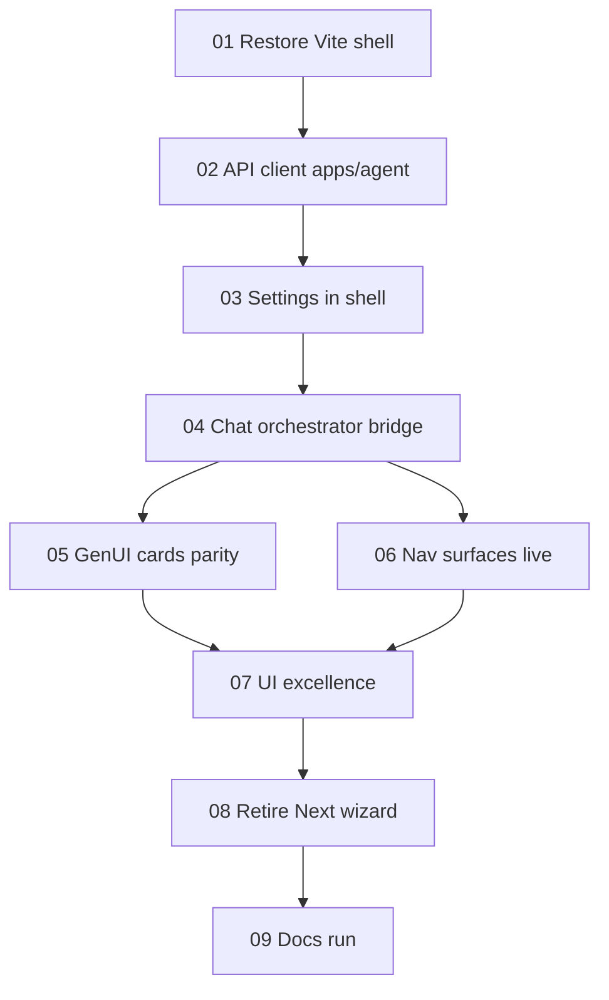

# Prompt Plan

## Developer Overview

- **Goal:** Make «همراه لیارا» feel like a Cursor-style agent workspace: chat-first shell from `main`’s LiaraOps UI, with the full `apps/agent` companion backend (orchestrator, deploy, ops, troubleshoot, settings) living inside that environment.
- **UI authority:** Branch `main` (also aligned with `kobra/main` for `src/` + `backend/` MVP) — Vite React agent workspace (`src/App.tsx`: sidebar, chat, Inspector, GenerativeCard, HITL).
- **Backend authority (product):** Current companion `apps/agent` (phases 0–6), not the thinner `backend/` MVP alone.
- **Decided:** Full product in Cursor-like Vite shell (`src/` from `main`) wired to `apps/agent`; UI excellent; no capability scope cut—implementation order only.
- **Open now:** Agreement to proposed prompt list.

## Decision Topics

| Topic | Status | Current answer | Next question |
| --- | --- | --- | --- |
| Outcome | decided | Primary UX = Cursor-like shell from `main`; all companion capabilities via chat+inspector+cards; wire to `apps/agent`; Next wizard demoted/removed gradually; UI excellence required | — |
| UI quality bar | decided | Excellent polish; motion/craft prioritized; `claudedesignskills` requested (see Supporting Inputs) | — |
| FE stack | decided | Product UI = Vite `src/` revived from `main`; wire to `apps/agent`; `apps/web` demoted/retired gradually | — |
| First loop | decided | **Not a scope cut.** Entire companion must work in the agent shell; slices are build order only | — |
| Prompt list | decided | 9 slices agreed + auto (2026-10-23) | — |
| UI baseline | decided | `main` chrome (nav/chat/inspector/cards) | — |
| Backend target | decided | `apps/agent` product BFF | — |
| Default locale | decided | FA / RTL first-class (EN optional if already in shell) | — |

## Run Mode

- mode: auto
- run state: complete
- pause reason: (none)
- enabled by: developer “agree auto” (2026-10-23) on prompt list
- completed: 2026-10-23 — all 9 agreed slices finalized

## Source Identity

| Source | Ref | Authority |
| --- | --- | --- |
| User intention | chat 2026-10-23 | Product intent |
| Cursor-like UI | git `main` / `kobra/main` → `src/` | Visual/interaction baseline |
| Companion product | `apps/agent`, prior plan `liara-companion` | Domain/API behavior |
| Thin MVP API | `backend/` on main | Legacy reference only unless chosen |

## Task Framing

- **Outcome:** Cursor-like agent workspace (from `main` UI) is the product surface; companion `apps/agent` powers it; user completes deploy/ops/troubleshoot/settings flows inside chat+inspector+approval cards. UI bar: excellent (not “MVP ugly”).
- **Affected:** End users; `src/` shell vs `apps/web`; `apps/agent`.
- **Scope:** Adopt `main` shell; wire companion APIs; FA/RTL first-class; high-craft motion/visual hierarchy.
- **Non-goals:** Full Cursor IDE clone; unrelated-history git merge unless asked; requiring Three.js/WebXR for an ops agent (unless a specific surface needs it).
- **Deliverables:** Polished agent shell + BFF wiring + in-chat core loops verified.

## Selected Skills

| Path | Reason | Status |
| --- | --- | --- |
| `.cursor/skills/discovery-orchestrator/SKILL.md` | Definition | active |
| `.cursor/skills/ux-design/SKILL.md` | Chat/agent workspace UX | active |
| `.cursor/skills/system-architecture/SKILL.md` | Two UIs + two backends → one product surface | active |
| `.cursor/skills/api-design/SKILL.md` | Wire Vite client → `apps/agent` contracts | active |
| `.cursor/skills/agent-orchestration/SKILL.md` | HITL / propose≠execute in chat | active |
| `.cursor/skills/generative-ui/SKILL.md` | Cards in chat/inspector | active if present |
| reliability / data-modeling | Only if persistence of threads moves server-side | deferred |

## Source Requirements

### From user

- UI like Cursor / famous agents (chat-centric workspace).
- Base visual/interaction on `main` branch UI.
- Everything for *this* system should work in that environment.

### From evidence on `main` UI

- Layout: left nav (New Chat, Services, Deployments, Monitoring, Domains, History, Settings), center chat, right Inspector (activity/logs/metrics).
- Generative cards + explicit approval (not chat-text approval).
- Conversation history (localStorage today on MVP).
- EN/FA copy toggle already present.
- Stack: Vite + React + Tailwind + motion; API on `:8000`, UI on `:5173`.

### From companion (`apps/agent`)

- Richer BFF: settings (Liara+Aval), orchestrator, deploy, ops, troubleshoot, patch, maintain.
- Next.js `apps/web` currently exposes step wizards + GenUI registry — not chat-first.

## Clarifications

- 2026-10-23: Developer chose recommendation (shell `main` + `apps/agent`). UI must be excellent; attached `/claudedesignskills`.
- 2026-10-23: FE stack = revive Vite `src/` from `main` (developer accepted recommendation).
- 2026-10-23: Developer rejected phased “first loop” questions — **whole project must work** in the agent shell; sequencing ≠ reduced scope.

## Structure and Boundaries

(pending Outcome)

## Technical Decisions

| Decision | Choice |
| --- | --- |
| Product FE | Vite + React `src/` from `main` (port 5173) |
| Product BFF | `apps/agent` (port 8000) |
| Legacy | Thin `backend/` not product path; Next `apps/web` secondary then retire |
| UI craft | Excellent polish; Motion-first (claudedesign full pack optional install) |

## Supporting Inputs

- Inspected `main:src/App.tsx`, Inspector, conversations, README (LiaraOps AI).
- Working tree on `main-kamyar-before-kobra`; `src/` exists on `main` not in working tree.
- `claudedesignskills`: user-attached; currently a **catalogue stub** unless marketplace package is installed. Main UI already uses `motion` (Framer). For ops-agent UI, prefer Motion/micro-interaction craft over 3D/WebXR suites unless a slice explicitly needs them.
- Unrelated-histories pull to `kobra` — out of scope unless requested.

## Assets

(none)

## Conflicts / Open Questions

1. ~~Primary shell~~ → Vite `src/` from `main`.
2. ~~Phased capability cut~~ → rejected; full companion in shell.
3. Thread persistence: prefer Case/DB-backed when wiring; localStorage OK as interim — implementation detail in slices.
4. Retire `apps/web` after shell reaches parity — in prompt list.

## Assumptions

- Product behavior remains `apps/agent` + PRD honesty (HITL, registry, secrets).
- Visual baseline is LiaraOps `src/` on `main`, not a literal Cursor IDE clone.

## Deliverables and Evidence of Success

(provisional) User can open agent workspace, chat a goal, see inspector activity, get plan/approval cards, approve a gated action against companion APIs.

## Repository Quality Contract

- New/changed FE packages must have runnable scripts; do not claim App Factory root checks that do not exist.
- Preserve `.env` secrets; no unrelated-history force merges without explicit ask.

## Prompt Decomposition Strategy

Build order only (not product cuts): restore shell → client→`apps/agent` → settings/chat core → map all companion flows into chat/inspector/cards → polish UI → retire Next wizard → docs/runbook.

## Agreed Prompt List

Status: **agreed** + auto execution authorized (2026-10-23)

| # | Title | Goal | Depends | Parallel |
| --- | --- | --- | --- | --- |
| 01 | Restore Vite shell | Checkout/bring `src/` + root Vite tooling from `main` onto working branch; runs on :5173; excellent base visual | — | no |
| 02 | API client → apps/agent | Replace thin `backend` client with `apps/agent` contracts (settings, health, CORS) | 01 | no |
| 03 | Settings + Aval/Liara in shell | Full settings UX in shell; secrets never echoed; prove-read | 02 | no |
| 04 | Chat orchestrator bridge | User messages drive companion orchestrator (case/plan/approve/execute/verify); Inspector shows timeline | 03 | no |
| 05 | GenUI cards parity | Plan/approval/evidence/diagnosis/ops/domain/deps/patch/monitor cards in chat/inspector allowlist | 04 | no |
| 06 | Nav surfaces live | My Services, Deployments, Monitoring, Domains, History backed by real agent APIs | 04 | after 04; can follow 05 |
| 07 | UI excellence pass | Motion, hierarchy, empty/loading/error, FA/RTL polish (Motion-first; claudedesign if installed) | 05, 06 | no |
| 08 | Retire Next wizard | Demote/remove `apps/web` as primary; README points to Vite shell | 07 | no |
| 09 | Docs + run | Update docs for agent-workspace UX + how to run | 08 | no |

**Acceptance (global):** Every companion capability reachable from the shell without requiring the Next wizard; HITL preserved; UI quality bar met; `apps/agent` tests still pass.

## Prompt Dependency Map

## Drafted Prompts

- `01-restore-vite-shell.md` — finalized
- `02-api-client-apps-agent.md` — finalized
- `03-settings-shell.md` — finalized
- `04-chat-orchestrator-bridge.md` — finalized
- `05-genui-cards-parity.md` — finalized
- `06-nav-surfaces-live.md` — finalized
- `07-ui-excellence.md` — finalized
- `08-retire-next-wizard.md` — finalized
- `09-docs-run.md` — finalized

## Execution Handoffs

- 01–08 — finalized (prior)
- 09 → [Docs run 09](addea0b7-4e30-4bd5-9fb2-831a772a3f79) — finalized

## Prompt Execution Progress

- 01–08 — finalized (prior entries)
- 09-docs-run.md
  - status: finalized
  - execution: [Docs run 09](addea0b7-4e30-4bd5-9fb2-831a772a3f79)
  - verification: path smoke OK; README + `docs/liara-companion.md`; coordinator restored `docker-compose.yml` (Postgres :5433)
  - finalization basis: auto, verified against agreed criteria

## Reconciliation Notes

- All 9 slices finalized. Product surface = Vite shell + `apps/agent`. Soft recovery: `apps/agent` `.py` restored from subagent transcripts; `docker-compose.yml` restored from `ea70573`.

## Learning Candidates

None observed.

## Progress

- 2026-10-23: auto-run complete (01–09).
