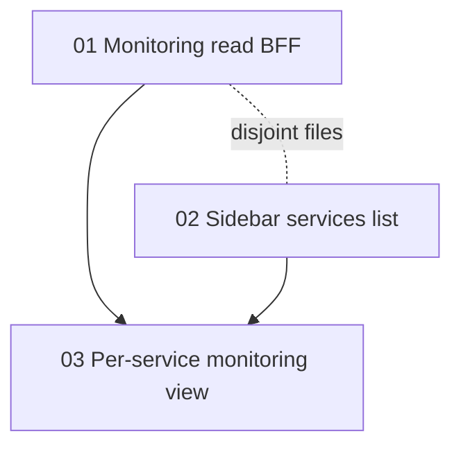

# Prompt Plan

## Developer Overview

- **Goal:** سرویس‌های لیارا به‌عنوان موجودیت مستقل حساب کاربری در سایدبار (بالای پوشه‌ها) با نقطه وضعیت؛ کلیک → مانیتورینگ همان سرویس در ناحیه اصلی (وضعیت زنده، CPU/RAM در صورت دسترسی API، لاگ‌های اخیر + CTA Investigate).
- **Expected outputs:** Delivered — BFF monitoring read; status tones; sidebar Services; per-service monitoring main view.
- **Ownership:** UI `src/`; BFF `apps/agent/app/api/liara.py`.
- **Boundaries:** no new writes; no folder↔service binding; API gaps surfaced.
- **Acceptance evidence:** unit/integration tests passed for BFF + FE mapping/schema; live UI smoke not run.
- **Open decisions:** none. Auto-run complete.

## Decision Topics

| Topic | Status | Current answer | Next question |
| --- | --- | --- | --- |
| Outcome | decided | سایدبار سرویس‌ها + نقطه وضعیت + مانیتورینگ per-service | — |
| Monitoring content | decided | وضعیت زنده + CPU/RAM + لاگ اخیر + Investigate | — |
| Panel placement | decided | ناحیه اصلی (NavigationView / main pane) | — |
| Folder coupling | decided | سرویس مستقل از پوشه؛ حتی بدون فولدر نمایش داده شود | — |
| Status tones | decided | آنلاین سبز؛ خطا قرمز؛ استاپ خاکستری؛ ناشناخته muted | — |
| Prompt list | decided | 3 اسلایس؛ توافق 2026-10-23 («بله») | — |

## Run Mode

- mode: auto
- run state: complete
- enabled by: `/hitl-define --auto` (2026-10-23) + list agreement («بله»)
- pause reason: (none)
- completed: 2026-10-23 — all 3 agreed slices finalized

## Source Identity

| Source | Ref | Authority |
| --- | --- | --- |
| User intention | chat FA 2026-10-23 | Primary |
| Challenge brief | `challenge.md` Monitoring & Maintenance | Challenge capabilities |
| Prior UX plan | `.hitl/prompts/companion-chat-ux/` | Folder-first shell (complete) |
| Codebase | `App.tsx`, `NavigationView.tsx`, `liara_client.py`, `api.ts` | Current wiring |

## Task Framing

- **Outcome:** کاربر سرویس‌های لیارا را بالای پوشه‌ها می‌بیند، سلامت تقریبی را از نقطه وضعیت می‌فهمد، و با کلیک مانیتورینگ همان سرویس را در main pane می‌بیند — هم‌راستا با پایش `challenge.md`.
- **Affected:** End users (FA/RTL)؛ سایدبار و nav؛ BFF Liara read paths.
- **Scope:** لیست حساب‌محور؛ نگاشت وضعیت؛ BFF برای detail/metrics/logs؛ UI مانیتورینگ per-service؛ سیم‌کشی کلیک سایدبار.
- **Non-goals:** اتصال سرویس↔پوشه؛ داشبورد incident عمومی به‌عنوان هدف اصلی کلیک؛ write/restart از این اسلایس‌ها؛ نصب claudedesignskills / انیمیشن‌های سنگین؛ clone کامل پنل لیارا.
- **Deliverable types:** Code (UI + BFF) + tests/verification.

## Selected Skills

| Path | Reason | Status |
| --- | --- | --- |
| `.cursor/skills/discovery-orchestrator/SKILL.md` | Coordination | active |
| `.cursor/skills/agent-workspace-ux/SKILL.md` | Sidebar vs folder-first; global vs workspace surfaces | active |
| `.cursor/skills/ux-design/SKILL.md` | Status affordance, empty/error states, a11y | active |
| `.cursor/skills/api-design/SKILL.md` | New Liara read BFF contracts | active |
| `claudedesignskills` (marketplace stub) | Not required for status dots / monitoring panel | deferred / not used |

## Source Requirements

### From user (supplied)

- اگر سرویس در لیارا هست، بالای پوشه‌ها لیست شود.
- کنار سرویس‌ها: آنلاین = نقطه وضعیت؛ خطا = قرمز؛ استاپ = خاکستری.
- کلیک → نمایش monitoring.
- رجوع به قابلیت‌های پایش در `challenge.md`.
- پاسخ‌ها RTL.
- تأیید: پنل per-service (وضعیت + CPU/RAM + لاگ + Investigate).
- تأیید: باز شدن در ناحیه اصلی.
- تأیید: سرویس موجودیت مستقل؛ ربطی به پوشه ندارد.

### From challenge.md (Monitoring & Maintenance)

- سلامت سرویس و منابع (CPU/RAM در صورت دسترسی).
- لاگ‌های مرتبط.
- اعلام محدودیت API وقتی داده در دسترس نیست.

## Clarifications

- «Monitoring» در این تسک = داشبورد per-service، نه صرفاً لیست incidentهای `maintain`.
- لیست فعلی سرویس‌ها از `prove-read` می‌ماند برای کاتالوگ سبک؛ مانیتورینگ از endpointهای جدید detail/metrics/logs تغذیه می‌شود.

## Structure and Boundaries

```text
Sidebar (account-global)
  Services section  ← NEW (above Folders)
  Folders section   ← existing workspace-scoped chats
  Wallets / Settings

Main pane
  New Chat | Settings | Service Monitoring (selected service)  ← NEW wiring
```

- **Ownership:** services list state می‌تواند در `App.tsx` بماند (قبلاً `services`/`refreshCatalog`)؛ monitoring fetch در view/API جدید.
- **Does not own:** write ops, folder↔service binding, GenUI chat cards beyond Investigate handoff.

## Technical Decisions

| Decision | Choice | Reason |
| --- | --- | --- |
| Status tones | map Liara `status`/`isDeployed`: RUNNING/STARTED/READY/ACTIVE → online (green); FAILED/ERROR/CRASH → error (red); STOPPED → stopped (gray); else unknown (muted) | Matches user + existing `ops.post_action_health` healthy set |
| Catalog source | keep `getServices` via prove-read for sidebar list | Already wired; avoid duplicate list API unless needed |
| Monitoring reads | new BFF under `/api/liara/projects/{name}/…` wrapping `get_project`, `get_cpu_metrics`, `get_memory_metrics`, `get_logs` | Client methods exist; no dashboard BFF today |
| API gaps | show explicit empty/unavailable copy when metrics/logs missing | challenge.md requirement |
| Panel host | extend/reuse `NavigationView` Monitoring (or dedicated service-monitor mode) selected from sidebar click | Existing nav surface orphaned from sidebar |
| Folder gate | services + monitoring work without local folder | Decided independent entity |
| Motion | reuse `.status-dot` CSS; no claudedesignskills | Proportional |

## Supporting Inputs

- `challenge.md` lines 19–23 (monitoring).
- Existing `.status-dot` / `.status-badge` in `src/index.css` and My Services cards.
- `LiaraClient.get_project` / metrics / logs; healthy statuses in `ops.py`.

## Assets

(none)

## Conflicts / Open Questions

- (none blocking) Exact Monitoring view layout polish deferred to implementer within existing design system.
- (none)

## Assumptions

- Liara API token in Settings is required to load services; without it, empty/error copy — not a fake list.
- Prove-read status string is enough for sidebar dots; monitoring panel refreshes richer detail on open.
- Investigate CTA reuses existing chat handoff pattern from My Services cards.

## Deliverables and Evidence of Success

1. سایدبار: بخش سرویس‌ها بالای پوشه‌ها، مستقل از فولدر.
2. نقطه وضعیت با سه tone اصلی (+ unknown).
3. کلیک → main pane مانیتورینگ همان سرویس با وضعیت و در صورت امکان CPU/RAM/لاگ.
4. اعلام واضح وقتی متریک/لاگ در دسترس نیست.
5. تست‌های BFF برای happy/404/unauthorized؛ smoke/UI یا unit برای نگاشت وضعیت.

## Repository Quality Contract

- Root README: Vite `:5173` + `apps/agent` `:8000`.
- Verify: `apps/agent` pytest for new routes; frontend vitest for status mapping if extracted; manual smoke of sidebar → monitoring when token present.
- Do not invent Liara upstream APIs; surface gaps.

## Prompt Decomposition Strategy

Vertical slices: (1) BFF read contract, (2) sidebar list + tones, (3) monitoring main view wired to BFF + click. UI list can use existing catalog while monitoring waits on BFF — slice 2 unblocked after status helper exists (can ship with client-side map on prove-read status); slice 3 depends on 1.

## Agreed Prompt List

Agreed 2026-10-23.

### 01 — Liara monitoring read BFF

- **File:** `01-monitoring-read-bff.md`
- **Depends on:** —
- **Blocks:** 03
- **Can run in parallel with:** 02 (disjoint files)
- **Expected touched areas:** `apps/agent/app/api/liara.py`, tests
- **Execution status:** finalized
- **Skills:** api-design

### 02 — Sidebar services above folders

- **File:** `02-sidebar-services-list.md`
- **Depends on:** —
- **Blocks:** 03
- **Can run in parallel with:** 01
- **Expected touched areas:** `src/App.tsx`, `src/lib/serviceStatus.ts`, CSS
- **Execution status:** finalized
- **Skills:** agent-workspace-ux, ux-design

### 03 — Per-service monitoring main view

- **File:** `03-service-monitoring-view.md`
- **Depends on:** 01, 02
- **Blocks:** —
- **Can run in parallel with:** —
- **Expected touched areas:** `App.tsx`, `NavigationView.tsx`, `api.ts`, schemas
- **Execution status:** finalized
- **Skills:** agent-workspace-ux, ux-design, api-design

## Prompt Dependency Map



## Drafted Prompts

- `01-monitoring-read-bff.md` — ready
- `02-sidebar-services-list.md` — ready
- `03-service-monitoring-view.md` — ready (blocked until 01+02 finalized)

## Execution Handoffs

- All slices finalized. Review/submit remain manual.

## Prompt Execution Progress

- 01-monitoring-read-bff.md
  - status: finalized
  - execution conversation / checkout: [01 builder](e2a51541-b899-47cc-b0bb-31cdc5d6baff); coordinator verified
  - changed files / artifacts: `apps/agent/app/api/liara.py`, `apps/agent/tests/test_liara_monitoring.py`, `execution-notes/01-monitoring-read-bff.md`
  - verification run and results: `uv run pytest tests/test_liara_monitoring.py -q` → 11 passed
  - verification not run: live Liara; full agent suite
  - finalization basis: auto, verified against agreed criteria
  - implementation decisions: combined `GET /api/liara/projects/{name}/monitoring`
- 02-sidebar-services-list.md
  - status: finalized
  - execution conversation / checkout: [02 builder](2fab0690-d726-4456-b67e-925aca74aecf); coordinator verified
  - changed files / artifacts: `src/lib/serviceStatus.ts`, `serviceStatus.test.ts`, `App.tsx`, `index.css`, `execution-notes/02-sidebar-services-list.md`
  - verification run and results: `npm test -- src/lib/serviceStatus.test.ts` → 8 passed
  - finalization basis: auto, verified against agreed criteria
  - implementation decisions: sidebar above folders; `selectedServiceId` + Monitoring nav
- 03-service-monitoring-view.md
  - status: finalized
  - execution conversation / checkout: [03 builder](10a22bd2-9fd6-4493-a792-2f6e666df4b6); coordinator verified
  - changed files / artifacts: `schemas.ts`, `api.ts`, `schemas.nav.test.ts`, `NavigationView.tsx`, `App.tsx`, `index.css`, `execution-notes/03-service-monitoring-view.md`
  - verification run and results: `npm test -- src/lib/schemas.nav.test.ts src/lib/serviceStatus.test.ts` → 18 passed
  - verification not run: live Liara/UI smoke; full suite
  - finalization basis: auto, verified against agreed criteria
  - implementation decisions: per-service Monitoring pane; incidents fallback when none selected

## Reconciliation Notes

(none)

## Learning Candidates

- claudedesignskills stub attached but not useful for this shell feature; no standing skill change proposed.

## Progress

- 2026-10-23: Intention framed; monitoring content, placement, folder independence decided; plan created; prompt list proposed for agreement.
- 2026-10-23: List agreed («بله»); prompts written; auto-run started; 01 building.
- 2026-10-23: 01 finalized (11 pytest); 02 building.
- 2026-10-23: 02 finalized (8 vitest); 03 building.
- 2026-10-23: 03 finalized (18 vitest); auto-run complete.
