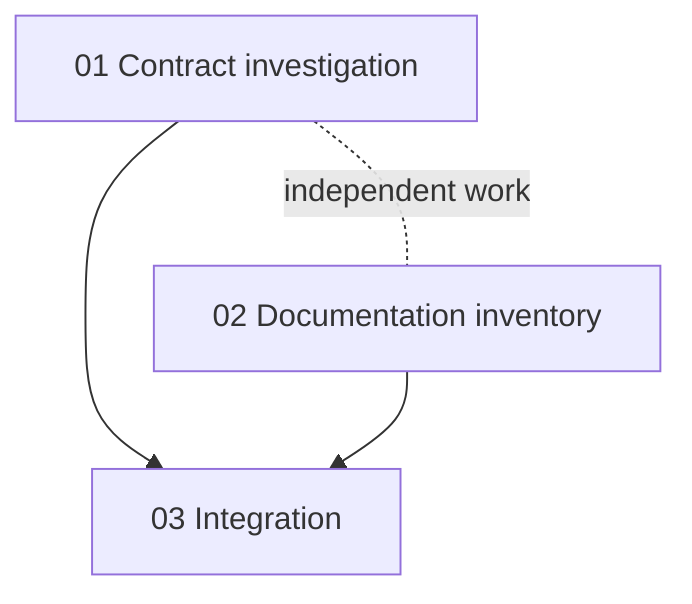

# Prompt plan contract

Shared artifacts and rules for `/hitl-define`, `/hitl-build`, `/hitl-next`, and `/hitl-improve`. Command-specific stages stay in `.cursor/commands/`. The human HITL map is [docs/guides/hitl.md](../../guides/hitl.md).

## Shared memory

Use `.hitl/prompts/<issue-key-or-short-task-name>/prompt-plan.md`. Keep assets in its `assets/` directory and numbered prompts directly beside the plan, named `<two-digit-index>-<up-to-three-word-name>.md`. Use stable descriptive filenames and relative links where useful. Create directories only when needed.

The plan is persistent coordination state, not a substitute for checking current code and artifacts. Update it after meaningful discovery stages and execution transitions. Preserve supplied source identity and references. Separate observations, assumptions, decisions, and unresolved conflicts. Older UI-oriented plans may be adapted without losing decisions or execution history.

Use this template; mark irrelevant sections briefly rather than inventing content:

```md
# Prompt Plan
## Developer Overview
<!-- Brief goal, expected outputs, directory ownership, public APIs/boundaries, slice order, acceptance evidence, and open decisions. -->
## Decision Topics
<!-- Short topic names, status (open/proposed/decided/deferred), current answer, and next question. -->
## Run Mode
<!-- mode: manual|auto; run state: active|paused|complete; enabled by; pause reason, if any. -->
## Source Identity
## Task Framing
<!-- Outcome, affected users/systems, scope, non-goals, deliverable types. -->
## Selected Skills
<!-- Path, selection reason, relevant concerns, active/deferred status. If --skills-first was used, record its findings, requested additions, approval outcomes, and explicit no-more-skills confirmation after the preflight gate. -->
## Source Requirements
## Clarifications
## Structure and Boundaries
## Technical Decisions
## Supporting Inputs
<!-- Source, authority, evidence limitations. -->
## Assets
## Conflicts / Open Questions
<!-- Include deferred questions and what will unblock them. -->
## Assumptions
## Deliverables and Evidence of Success
## Repository Quality Contract
## Prompt Decomposition Strategy
## Agreed Prompt List
## Prompt Dependency Map
## Drafted Prompts
## Execution Handoffs
## Prompt Execution Progress
## Reconciliation Notes
## Learning Candidates
<!-- Evidence of definition-quality gaps, expected better output, suspected skill/selection cause, status, and approval/change references. `/hitl-define` can review a consequential candidate inline; `/hitl-improve` handles accumulated or deferred candidates. -->
## Progress
```

## Approval and uncertainty

In manual mode, before decomposition and before writing ready prompt files, obtain clear agreement to that action. `/hitl-build` implements the chosen prompt file as written; do not rewrite it into a new plan. Before orchestration finalizes a non-final slice, obtain confirmation that it is complete. The last remaining `/hitl-build` finalizes its slice in place; it does not require another `/hitl-next`. Natural affirmative responses suffice; corrections and ambiguity do not. Existing explicit authorization covering the same action and scope counts—do not demand repeated ritual confirmations.

In auto mode, `/hitl-define` remains collaborative. Confirm material requirements and the proposed prompt list with the developer. Agreement to that list authorizes writing and executing its unblocked slices without the later routine prompt-writing, prompt-selection, and slice-finalization questions. Use [the auto-run procedure](./auto-run.md) for the loop, verification, updates, and stop conditions. Auto mode is not consent to change the agreed scope or to run review or submit commands.

An inline skill improvement during `/hitl-define` requires approval of its concrete skill and catalog edits before activation, in either mode. Agreement to task scope, prompt list, or auto mode does not approve standing skill changes. An unapproved draft remains a learning proposal and must not be used as active guidance.

With `--skills-first`, the skill preflight precedes definition in either mode. Do not start task framing, write the task plan, or make definition decisions until the developer explicitly confirms that no more skills should be added. This confirmation is separate from approval of any concrete skill edit and from later prompt-list agreement. Record the preflight outcome in the plan after the gate clears.

Confirm material inferred requirements, conflicting sources, and consequential scope/ownership changes before relying on them. Ordinary investigation, skill selection, and minor implementation choices within agreed scope do not each require a new gate. Keep questions phase-appropriate and proportional to uncertainty. User instructions take precedence over this workflow.

Investigation can be a complete slice whose deliverable is evidence and a recommendation. Dependent implementation remains conditional until reconciliation establishes what the findings actually support.

## Dependency map and parallel work

For each prompt, record `depends on`, `blocks`, `can run in parallel with`, `expected touched areas`, and `execution status`. Show the map as Mermaid, for example:



Parallel eligibility depends on decisions, ownership, contracts, files, and verification fixtures—not titles. Separate conversations do not provide filesystem isolation. Use separate checkouts where appropriate, or disjoint edits; record where results live. Do not assume branches are merged or deploy anything as part of reconciliation without authorization.

In manual mode, executors update only their own progress entry. Immediately before saving a shared plan, reread it and preserve others' changes. When simultaneous writes cannot be coordinated safely, each executor writes `execution-notes/<prompt-stem>.md` inside the task folder using the progress fields below; the orchestrator incorporates these reports sequentially. In auto mode, the coordinator alone updates the shared plan; each slice builder writes its own execution note. Executors in separate checkouts report their result location; the orchestrator owns changes to the global list, dependency map, and reconciliation notes. Never replace the shared plan from a stale whole-file copy.

## Progress contract

Statuses are `not written`, `handed off`, `building`, `implemented`, `finalized`, `blocked`, and `skipped`. Claim a prompt as `building` before implementation or subagent dispatch so another conversation cannot offer it. Treat leftover `planning`, `planned`, or `implementing` entries as in-flight and exclude them from the build picker. “implemented” means the agreed deliverable is produced, including non-code deliverables. “finalized” means either the user accepted completion in manual mode or the coordinator verified the agreed acceptance criteria in auto mode; record the finalization basis and disclose verification limitations. In manual mode, the last remaining `/hitl-build` finalizes its slice when every other agreed prompt is `finalized` or `skipped`; other slices stop at `implemented` for orchestration confirmation. In auto mode, the coordinator reconciles and finalizes each verified slice before advancing dependent work.

```md
- 01-example.md
  - status:
  - execution conversation / checkout:
  - changed files / artifacts:
  - verification run and results:
  - verification not run and limitations:
  - finalization basis, if finalized:
  - implementation decisions / findings:
  - deviations from prompt:
  - specialist findings / selection changes:
  - learning candidates, if any:
  - implications for remaining prompts:
  - blocking reason / skipped rationale, if applicable:
```

A skipped dependency supplies no artifact. Before unblocking dependents, verify that required outcomes exist or agree to revise their scope. Resolve blocked reasons explicitly. Preserve prior reports when a slice is revised.

## Prompt-file contract

Each prompt must be usable in a fresh conversation with the sibling plan and referenced evidence. Include only the slice's relevant context, accepted decisions, dependencies, specialist paths and standards, and quality requirements. Required source files must exist or be clearly identified as deliverables to create. Provisional drafts must be labeled and must not be represented as executable before prerequisites are resolved.

Keep the **Developer Overview** near the top of the plan and a short **Developer Review** card near the top of each prompt. These are review surfaces, not separate instructions for the executor. Keep them consistent with the detailed sections when decisions change. The overview gives the goal, planned outputs, important directories and ownership, public APIs and boundaries, slice dependencies, acceptance evidence, and open decisions. The card gives the slice's goal, expected files or structure, public API/boundary changes, dependencies, acceptance checks, and any decision needed from the developer. Omit inapplicable fields and incidental file lists. The developer can inspect the full prompt when desired.

```md
# <Prompt Title>
## Goal
## Developer Review
<!-- Brief output, important files/ownership, public APIs/boundaries, dependencies, acceptance evidence, open decision. -->
## Context
## Requirements
## Relevant Skills
## Technical Notes
## Structure / File Guidance
## Implementation Instructions
## Acceptance Criteria
## Verification
## Execution Handoff
## Non-goals
```

“Implementation Instructions” describes execution of any agreed artifact, not necessarily code. Specify observable acceptance evidence and feasible checks rather than vague quality claims. For an applicable installed specialist, link its actual skill file; do not carry references to unavailable repository-specific skills.

Every execution handoff names the prompt and sibling plan, limits work to the chosen slice, and requires a progress report. In manual mode, direct a dedicated conversation to `/hitl-build <prompt-folder>` and return to `/hitl-next <prompt-folder>` unless it is the last remaining slice. In auto mode, direct the coordinator to hand the claimed slice to `hitl-slice-builder` and reconcile its execution note before continuing. Include shared-plan coordination instructions when parallel work is possible.

Completion means all agreed prompts are finalized or explicitly skipped, with outcomes and skip rationales recorded. Each non-skipped prompt has its numbered file. Writing files alone does not complete execution.
